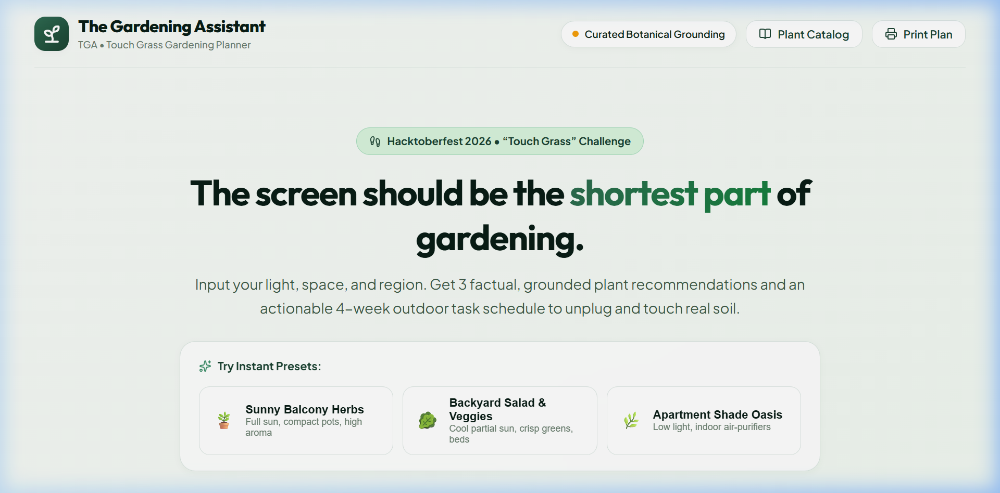
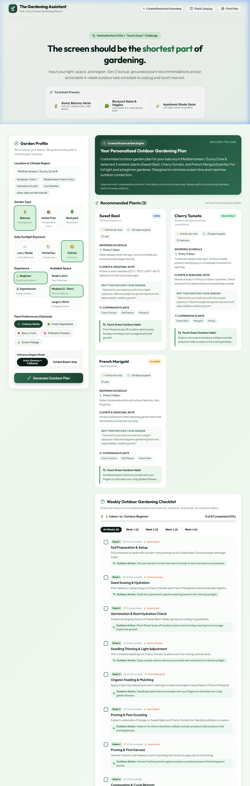
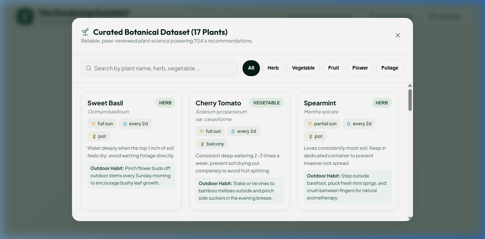
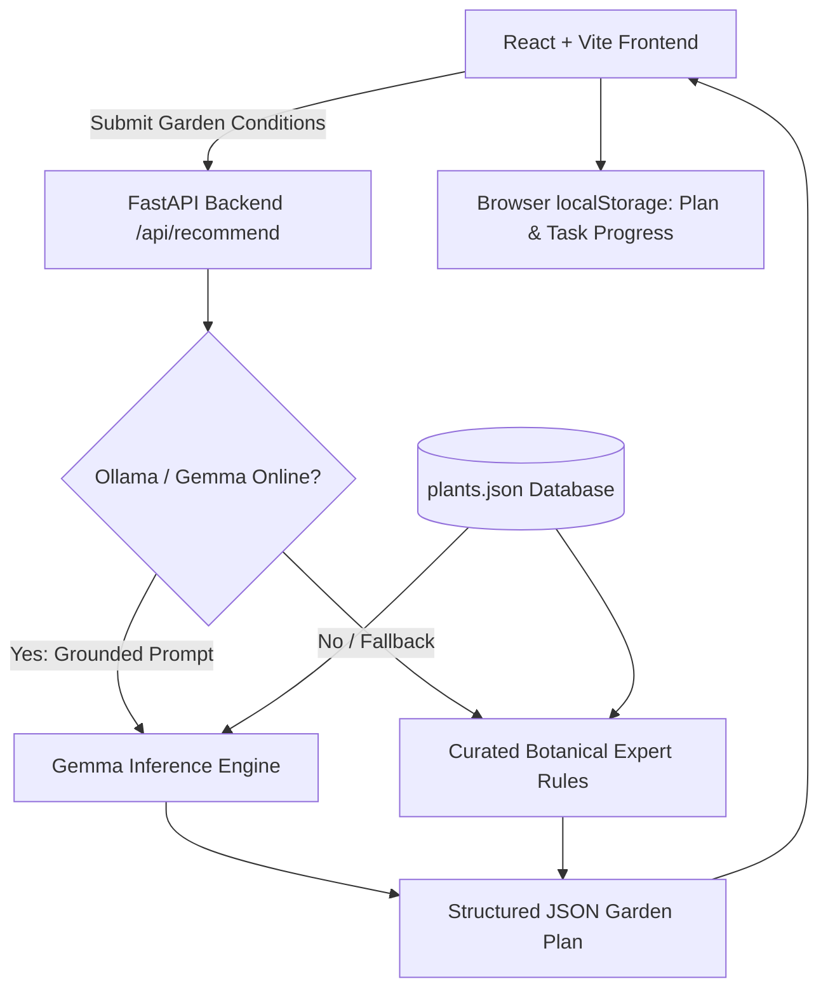

# The Gardening Assistant (TGA) 🌱

> **Hacktoberfest 2026 Challenge:** *Touch Grass*  
> **Partner Category Target:** *Best Use of Gemma*  
> **Philosophy:** *“The screen should be the shortest part of gardening.”*

---

## 📖 Overview

**The Gardening Assistant (TGA)** is an AI-powered personalized gardening planner designed to get you off your computer and into the soil. Rather than keeping you glued to an endless screen, TGA quickly gathers your local growing conditions (sunlight exposure, garden type, experience level, and available space), grounds its reasoning in a curated botanical dataset, and delivers:

1. **3 Targeted Plant Recommendations** with watering schedules, growing cycles, and companion planting tips.
2. **"Touch Grass" Sensory Prompts** for each plant (e.g. pruning stems, crushing mint leaves for natural scent, checking morning blooms).
3. **An Actionable 4-Week Outdoor Checklist** with interactive progress tracking that saves locally to your browser.
4. **Transparent Hybrid Intelligence**: Powered by Google’s open-weight **Gemma** model via local Ollama inference, paired with a deterministic botanical rule engine fallback.

---

## 📸 Demo Preview

| Garden Profile & Presets | Personalized Plan & Outdoor Habits |
| :---: | :---: |
|  |  |

| Curated Botanical Dataset (Grounding Knowledge Base) |
| :---: |
|  |

---

## 🎯 Challenge Alignment & Partner Category

### 1. Hacktoberfest “Touch Grass”
Modern software engineering can trap developers at their desks for days. TGA directly addresses this by generating outdoor habits and hands-on soil activities:
- Every recommended plant includes a specific **Touch Grass outdoor sensory habit**.
- The 4-week checklist specifies exact estimated minutes outside (15–25 mins/session).
- Milestone status meters elevate you from *Seedling Starter* to *Master Green Thumb*.

### 2. Best Use of Gemma (Open-Weight AI)
TGA leverages Google's **Gemma** open-weight model through local Ollama inference (`gemma2:9b` / `gemma:2b`):
- **Local Sovereignty & Privacy:** Personal garden layout and household habits never leave your local machine.
- **Botanical Grounding:** Prompts inject curated, verified plant biology facts so Gemma personalizes advice without hallucinating care schedules or watering needs.
- **Deterministic Reliability:** If Ollama is offline or uninstalled, TGA falls back to an expert botanical scoring engine without degrading user experience.

### 3. Best Use of ElevenLabs (Hands-Free Outdoor Voice)
When hands are covered in moist soil and dirt outside, tapping a phone screen is messy:
- **Audio Guides:** Every plant card and weekly checklist item features a dedicated narration trigger.
- **Calm Outdoor Persona:** Calls ElevenLabs Text-to-Speech API (`/api/voice/narrate`) with calm pacing.
- **Zero-Dependency Fallback:** Automatically falls back to the browser's Web Speech API if unconfigured.

### 4. Best Use of SerpApi (Real-Time Frost & Climate Advisory)
Generic planting calendars fail because microclimates differ:
- **Live Search Engine:** Queries Google via SerpApi for average first and last frost dates for the user's specific city or region.
- **Agricultural Safeguard:** Injects real-time frost dates directly into the planning flow.

### 5. Best Use of Sentry Agent Tracing
- **AI Observability:** Integrates `sentry-sdk` in the FastAPI backend to trace Gemma token usage, inference latency, and fallback events.

### 6. Best Use of Render & Vercel
- **Render (`render.yaml`):** 1-click infrastructure blueprint for backend service and frontend static site.
- **Vercel (`vercel.json`):** Full-stack serverless deployment with edge CDN.

---

## 🏗️ Architecture



### Key Components

- **Frontend (`frontend/`)**: React 19 + Vite, rich botanical design system with bespoke Vanilla CSS, Google Fonts (*Plus Jakarta Sans* & *Outfit*), Lucide icons, responsive layout, and instant 1-click presets.
- **Backend (`backend/`)**: Python FastAPI with Pydantic validation, CORS middleware, and asynchronous health checking.
- **Botanical Dataset (`backend/app/data/plants.json`)**: Curated facts covering vegetables, culinary herbs, fruits, flowers, and foliage with sunlight ranges, watering frequencies, and climate notes.
- **Gemma Service (`backend/app/gemma_service.py`)**: Structured JSON prompt generator ensuring model outputs adhere to plant biology.
- **Deterministic Recommender (`backend/app/recommender.py`)**: Multi-variable heuristic scoring (sunlight compatibility, space limits, experience level, garden type).

---

## 🚀 Quickstart Guide

### Prerequisites
- **Node.js** (v18+)
- **Python** (v3.10+)
- *(Optional)* **Ollama** with Gemma pulled:
  ```bash
  ollama pull gemma:2b
  ```

### 1. Start the Backend API
In a terminal:
```bash
cd backend
python -m uvicorn app.main:app --host 127.0.0.1 --port 8000 --reload
```
The API documentation is accessible at: `http://127.0.0.1:8000/docs`

### 2. Start the Frontend
In a second terminal:
```bash
cd frontend
npm install
npm run dev
```
Open your browser at: `http://127.0.0.1:5173`

---

## 🌿 User Experience & Features

1. **Instant Presets for Rapid Demos**:
   - 🪴 **Sunny Balcony Herbs**: Full sun, containers, rapid kitchen wins (Basil, Thyme, Marigolds).
   - 🥬 **Backyard Salad & Veggies**: Partial sun, rich soil, cool season crops (Spinach, Kale, Radishes).
   - 🌿 **Apartment Shade Oasis**: Low light indoor containers (Pothos, Snake Plant, Boston Fern).
2. **Plant Catalog Modal**: Browse all 17+ plants in the factual database with search and category filtering.
3. **Outdoor Weekly Checklist**:
   - Filter by week (Week 1–4)
   - Progress bar with completion percentage
   - Checkbox persistence in `localStorage`
   - One-click progress reset
4. **Print Outdoor Plan**: Clean, printer-friendly CSS stylesheet so you can take your checklist out into the yard.

---

## ⚠️ Botanical Disclaimer & Limitations

- Local microclimates, frost dates, and seasonal weather variations significantly affect seed germination.
- TGA displays a mandatory seasonal advisory on every plan encouraging gardeners to check local frost calendars.
- Recommendations are grounded in general temperate and subtropical hardiness guidelines; unusual regional soil conditions (e.g. heavy alkaline clay) may require soil amendment before planting.

---

## 📜 License & Hacktoberfest Notes

Created for Hacktoberfest 2026. Free and open source under the MIT License.
